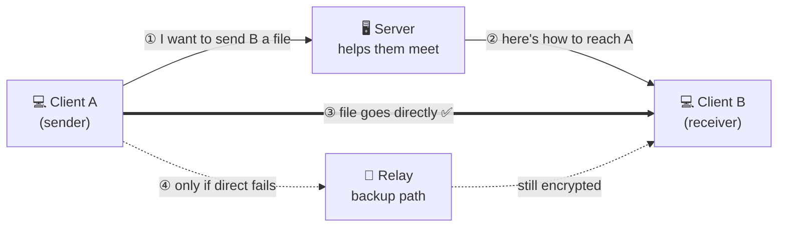
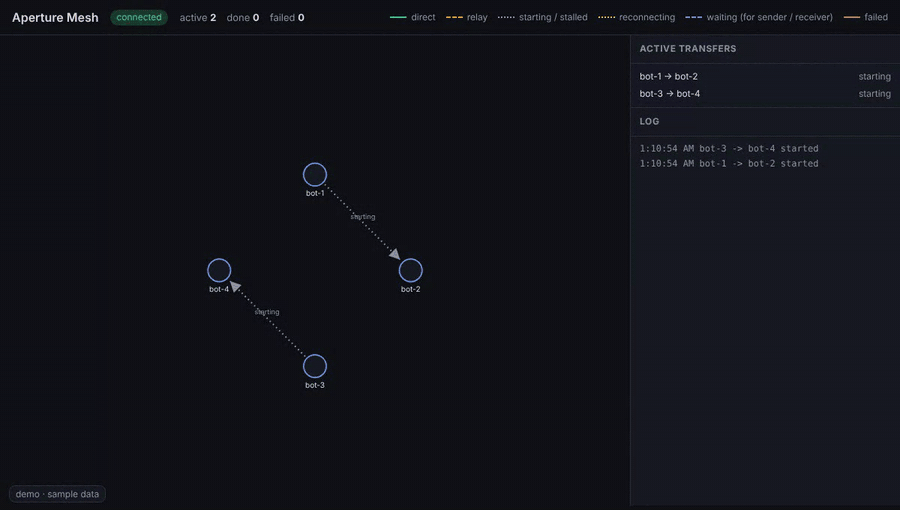

# Aperture

### Send files straight to each other.

When you send a file today, it usually goes up to someone's server first and then down to your friend. Aperture skips that. A small server only helps two computers **find each other**. After that, the file goes **directly** from one to the other.

And if something goes wrong halfway (Wi-Fi drops, someone closes the app, even the server goes down), **the transfer doesn't start over**. It picks up where it stopped.

> Aperture is a personal project, not a finished app yet. Today it runs as a command-line client, with test bots keeping the network busy.

---

## Why it matters

The internet relies on a few big servers. When they go down, or when a whole area gets cut off after a storm or an earthquake, people lose the ability to share anything at all.

Aperture is a step toward the other way. It starts with direct transfers that survive failures, and is heading toward **devices that can find each other and share on their own**, even when the network around them is broken.

---

## Watching it live

The mesh shows every transfer as it happens.

| You see | It means |
|---|---|
| ⚪ Circle | A user (a person or a test bot) |
| ➡️ Arrow | A file on its way, with how much has arrived |
| 🟢 Green | Sent **directly**, computer to computer |
| 🟠 Orange dashed | A direct path wasn't possible, so it goes through a **relay** (still encrypted) |
| 🟡 Yellow dotted | The connection dropped and it's **reconnecting** |
| 🟣 Purple dashed | The other side left, and the file is **saved and waiting** for them |
| ◌ Faded circle | That user is **offline** |
| ⚪ "already had it" | They already had this file, so nothing was sent |

---

## What you can count on

- 🔒 **Private:** files are encrypted, and the file data never passes through or stays on a server
- ✅ **Complete:** every piece is checked, so a broken or changed file can't arrive
- 🔁 **Resumes:** if anything stops, it continues from the same spot (it waits up to 30 minutes for the other side)
- 🛟 **Keeps going:** transfers already running finish even if the server goes down

Each of these was tested by breaking it on purpose: [test results](docs/fixes/PhaseB3d-cleanup.md).

---

## What's next

A dashboard to see the whole network at a glance, and later a simple app anyone can use.

👉 [Roadmap](docs/roadmap.md) · [How it's built](docs/README.md)

---

**Built with:** Rust · Iroh · Java · Redis · AWS SNS/SQS · Docker · Kubernetes (k3s) · Prometheus · Grafana
