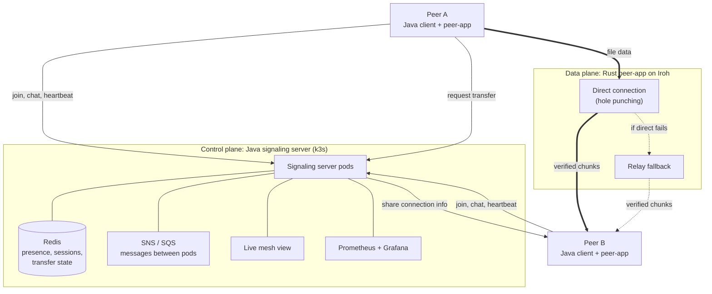

# Aperture

**A learning lab for peer-to-peer networking.**

What happens when two computers try to talk to each other directly, with no server in the middle? Sometimes it just works. Sometimes routers get in the way, Wi-Fi drops, or one side disappears halfway through. Aperture is where I explore that: a small P2P system that I keep breaking on purpose to see how it behaves, and then make more reliable.

---

## Architecture

The **control plane** helps peers find each other and keeps track of who's online. The **data plane** moves the files, peer to peer. File data never passes through the server.

---

## Iroh, in short

[Iroh](https://iroh.computer) is a Rust library for connecting devices directly.

- **Every peer has an ID** (a public key). You connect to an ID, not to an IP address.
- **It tries to connect directly** first, punching through home routers (NAT traversal).
- **If that fails, it uses a relay**, a server that only forwards encrypted data it can't read.
- **Connections are encrypted** end to end (QUIC).

---

## How file transfer works

1. The sender **offers** a file. The file gets a fingerprint (a BLAKE3 hash).
2. The receiver **asks for it** and pulls it in small pieces.
3. **Every piece is checked** against the fingerprint, so a changed or broken file can't slip through.
4. If something breaks halfway (a restart, a crash, the sender going offline), the pieces already received are kept, and the transfer **continues from where it stopped**.

---

## What happens when things break

Each of these was tested on purpose, with a hash check at the end.

| What breaks | What happens |
|---|---|
| The sender closes the app halfway | The receiver tries 3 times, then waits with its data **locked** on disk. When the sender is back, it continues from the same %. |
| The receiver closes the app halfway | The sender keeps sharing for up to 30 min. When the receiver is back, it restores its pieces and continues. |
| Either side restarts | Both sides compare what they remember with the server, then **resume, clean up, or report a clear failure**. Nothing stays stuck. |
| The file changes while the sender is offline | The transfer is stopped, and the receiver is told why. |
| **The server goes down** | Transfers **keep going directly**. Results are kept and sent when the server is back, so its records stay correct. |
| The server is gone for good | The client gives up after 10 minutes with a clear message. Saved transfers resume on the next start. |

---

## What's inside

- **A signaling server** (Java) running as several pods on Kubernetes, sharing state through Redis and AWS messaging
- **A peer app** (Rust, on Iroh) that does the actual connecting and file moving
- **Bots** that join, chat and send files to each other, so the system is always busy
- **A live mesh view** showing who's talking to whom, whether it went direct or through a relay, and who is offline

---

## How it grew

Each step started with something that broke, and ended with a test proving it was fixed.

**Now:** file transfer on iroh-blobs is done (Phase B3). **Next:** a live dashboard for the whole system. See the [roadmap](docs/roadmap.md).

---

## Questions I'm still chasing

- How often do two peers really manage to connect directly?
- What does falling back to a relay cost?
- What still needs a central server in a "decentralized" system?
- What would it take for this to keep working when the network is having a bad day?

---

## Built with

Rust · Iroh · Java · Redis · AWS SNS/SQS · Docker · Kubernetes (k3s) · Prometheus · Grafana

---

## Learn more

The full story (problems, fixes, decisions, experiments) lives in [`docs/`](docs/). The [roadmap](docs/roadmap.md) shows where it's heading next.

*Tested with a handful of peers across my laptop and a cloud machine (k3s, two server pods). Not production software, and not trying to be.*
