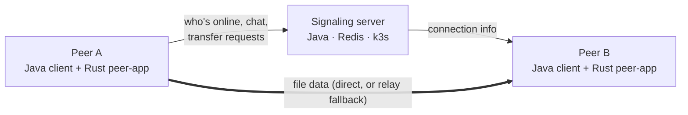
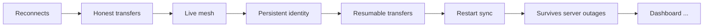

# Aperture

**A learning lab for peer-to-peer networking.**

Two computers sending files directly to each other, with no server in the middle. I break it on purpose (kill apps, drop the server, change files halfway) and then make it reliable.

---

## How it works

- **Control plane:** a Java server helps peers find each other and tracks transfers.
- **Data plane:** a Rust app on [Iroh](https://iroh.computer) moves the file peer to peer. It tries a direct connection first and falls back to a relay. File data never goes through the server.
- **Every piece is checked** against the file's BLAKE3 fingerprint, so a broken or changed file can't get through.

---

## What it survives

Tested on EC2 (k3s, 2 server pods), between two peers over the internet. Each one ended with a sha256 match.

| What I broke | Result |
|---|---|
| Killed the sender at 84% | Receiver retried, waited, then **resumed from 84%** when the sender came back |
| Killed the receiver at 71% | Sender kept sharing, receiver came back and **resumed from 71%** |
| Changed the file while the sender was offline | Transfer **stopped**, and the receiver was told why |
| **Scaled the server to 0** during a 1 GB transfer | Transfer **finished peer to peer**, and the results reached the server when it came back |

Full test list and known issues: [PhaseB3d-cleanup.md](docs/fixes/PhaseB3d-cleanup.md)

---

## Where it's at

**Done:** Phase B3, file transfer on iroh-blobs. **Next:** D1, a live dashboard. See the [roadmap](docs/roadmap.md).

---

## What's in the repo

| Path | What it is |
|---|---|
| `src/com/shobhit/Network_lab/` | Java signaling server (`Server.java`) and client (`Client.java`) |
| `peer-app/` | Rust peer-app on Iroh + iroh-blobs |
| `mesh.html` | Live mesh view: who's talking to whom, direct or relay |
| `tools/` | Test scripts for peer-app |
| `Dockerfile.*`, `k8s-*.yaml` | Images and k3s deployment |
| `docs/` | Problems, fixes, decisions, plans ([start here](docs/README.md)) |

---

## Built with

Rust · Iroh · Java · Redis · AWS SNS/SQS · Docker · Kubernetes (k3s) · Prometheus · Grafana

---

## Questions I'm still chasing

- How often do peers really connect directly?
- What does falling back to a relay cost?
- What still needs a central server in a "decentralized" system?

*Not production software, and not trying to be.*
