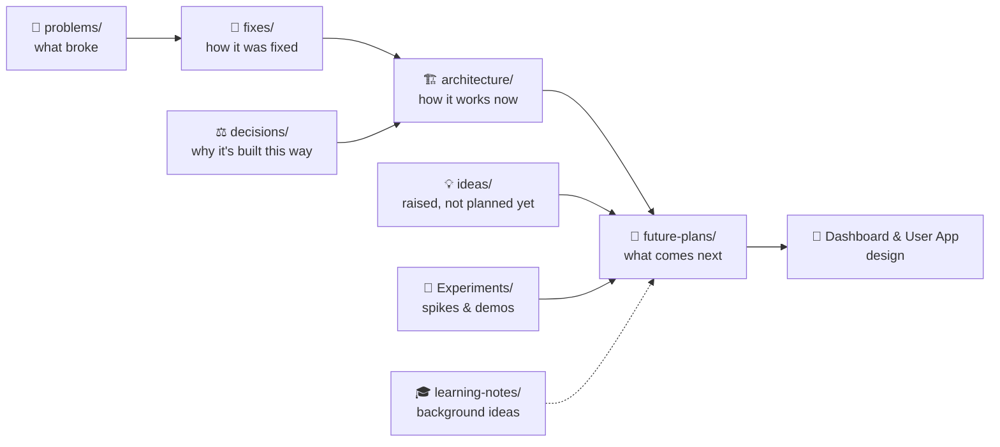
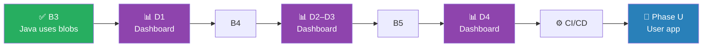

# 📚 Aperture Docs

A map of everything in `docs/`: what each file is about and where to find it.

> [!TIP]
> **New here?** Read these three in order:
> 1. 🗺️ [roadmap.md](roadmap.md): where the project is and what's next
> 2. 🏗️ [architecture/overview.md](architecture/overview.md): how the pieces fit together
> 3. 🔌 [peer-app-protocol.md](peer-app-protocol.md): how the Java client talks to peer-app

---

## How the docs are organized

| Folder | Holds | Status |
|---|---|---|
| 🏗️ `architecture/` | How the system works **today** |  |
| ⚖️ `decisions/` | Why things are built the way they are |  |
| 🐞 `problems/` | What broke, with evidence |  |
| 🔧 `fixes/` | How problems were solved |  |
| 💡 `ideas/` | Ideas raised during work, waiting for a phase |  |
| 🚀 `future-plans/` | Designed, not built yet |  |
| 📱 `Dashboard and User App Design/` | Dashboard (next) + user app (Phase U) |  |
| 🧪 `Experiments/` | Spikes and visual demos |  |
| 🎓 `learning-notes/` | Ideas behind the project |  |

---

## 🏗️ Architecture

> [!NOTE]
> These docs describe the code **as it is on `main`**. When the code changes, these change too.

| File | What it covers |
|---|---|
| [overview.md](architecture/overview.md) | Big picture: control plane, data plane, how they connect |
| [control-plane.md](architecture/control-plane.md) | Java signaling server, Redis, SNS/SQS, pods |
| [data-plane.md](architecture/data-plane.md) | Rust peer-app on Iroh: connections and transfers |
| [networking.md](architecture/networking.md) | NAT, hole punching, relays, ports |
| [peer-app-protocol.md](peer-app-protocol.md) | Every peer-app command and event (META3, blobs, B3c/B3d restart and recovery events, client exit codes) |

---

## ⚖️ Decisions

| # | File | Decision |
|---|---|---|
| 001 | [001-java-signaling.md](decisions/001-java-signaling.md) | Java for the signaling server |
| 002 | [002-redis-presence.md](decisions/002-redis-presence.md) | Redis for who's online |
| 003 | [003-iroh-data-plane.md](decisions/003-iroh-data-plane.md) | Rust + Iroh for moving files |
| 004 | [004-iroh-documents.md](decisions/004-iroh-documents.md) | Iroh Documents for swarm metadata *(future)* |
| 005 | [005-self-hosted-relay.md](decisions/005-self-hosted-relay.md) | Our own Iroh relay *(future)* |
| — | [transfer-state-in-redis.md](decisions/transfer-state-in-redis.md) | Transfer state lives in Redis |

> [!WARNING]
> `transfer-state-in-redis.md` also calls itself **003**. Rename it to `006-…` to keep the numbers unique (see Housekeeping).

---

## 🐞 Problems

| File | Problem |
|---|---|
| [File-transfer-bugs.md](problems/File-transfer-bugs.md) | Transfer bugs found by code review |
| [Before-PhaseB3c-restart-sync-findings.md](problems/Before-PhaseB3c-restart-sync-findings.md) | What went wrong after a restart, before B3c (client, peer-app and server disagreed) |
| [chat-reconnect-investigation.md](problems/chat-reconnect-investigation.md) | Why chat connections kept reconnecting |
| [direct-connection-failure.md](problems/direct-connection-failure.md) | Direct connections failing |
| [direct-connection-gap.md](problems/direct-connection-gap.md) | Why most transfers fell back to relay |
| [relay-fallback.md](problems/relay-fallback.md) | How and when the relay is used |
| [slow-transfers.md](problems/slow-transfers.md) | Slower-than-expected transfers |
| [peer-app-authentication-failed.md](problems/peer-app-authentication-failed.md) | "authentication failed" errors in peer-app |
| [transfer-state-vs-mesh-state.md](problems/transfer-state-vs-mesh-state.md) | Mesh showing something different from the real transfer |

> [!IMPORTANT]
> 🧾 **Evidence lives in [`problems/evidence/`](problems/evidence/).** Raw before/after logs for fixes A1–A4, bug 10 and mesh v2 S1. Every fix should point to its proof.

---

## 🔧 Fixes

| File | Fix |
|---|---|
| [chat-heartbeat-fix.md](fixes/chat-heartbeat-fix.md) | App-level heartbeat on the chat socket |
| [chat-reconnect-Fixed-design-plan.md](fixes/chat-reconnect/chat-reconnect-Fixed-design-plan.md) | Full reconnect redesign (checklist) |
| [reconnect-step3-fix.md](fixes/chat-reconnect/reconnect-step3-fix.md) | Client-side reconnect fixes |
| [Process-ownership.md](fixes/chat-reconnect/Process-ownership.md) | Same username in two processes: newest wins |
| [mesh-v2.md](fixes/mesh-v2.md) | Live transfer tracking + client limits |
| [PhaseB3c-restart-sync-paln.md](fixes/PhaseB3c-restart-sync-paln.md) | B3c: after a restart, client, peer-app and server agree (resume / clean up / report failed) + test results |
| [PhaseB3d-cleanup.md](fixes/PhaseB3d-cleanup.md) | B3d: first-try fix, locked state, clearer messages, startup watchdog, give-up, surviving server outages, mesh offline view + EC2 test results and known issues |

---

## 💡 Ideas

| File | Idea |
|---|---|
| [duplicate-file-check.md](ideas/duplicate-file-check.md) | Check the file's fingerprint before accepting: skip a file you already have, ask before downloading a changed version *(B4 or Phase U)* |

---

## 🚀 Future plans

### 📦 File transfer
| File | Plan |
|---|---|
| [File-transfer-improvement-plan.md](future-plans/File-transfer-improvement-plan.md) | Phase A → Mesh v2 → Phase B (blobs) |
| [transfer-resume-plan.md](future-plans/transfer-resume-plan.md) | Resuming interrupted transfers |
| [swarm-distribution-plan.md](future-plans/swarm-distribution-plan.md) | One file from many peers at once |

### 🌐 Networking
| File | Plan |
|---|---|
| [self-hosted-relay-plan.md](future-plans/self-hosted-relay-plan.md) | Our own Iroh relay |
| [dht-future-plan.md](future-plans/dht-future-plan.md) | DHT discovery alongside DNS |
| [Kademlia-DHT-id-space-mesh.md](future-plans/Kademlia-DHT-id-space-mesh.md) | ID-space view of the mesh |

### 🕸️ Mesh & dashboard
| File | Plan |
|---|---|
| [mesh-evolution-plan.md](future-plans/mesh-evolution-plan.md) | Mesh view from 20 bots to 1000+ users |
| [Mesh-3D-view-plan.md](future-plans/Mesh-3D-view-plan.md) | 3D layered mesh view |
| [Aperture-Dashboard.md](future-plans/Aperture-Dashboard.md) | Earlier dashboard plan |

### ⚙️ DevOps & learning paths
| File | Plan |
|---|---|
| [CI-CD_plan.md](future-plans/CI-CD_plan.md) | Separate server and client image builds |
| [Devops-roadmap.md](future-plans/Devops-roadmap.md) | Running Aperture like a small production service |
| [Distributed_systems-Networking-roadmap.md](future-plans/Distributed_systems-Networking-roadmap.md) | Long-term P2P / distributed systems path |
| [Chat-Session-resumption-plan.md](future-plans/Chat-reconnect/Chat-Session-resumption-plan.md) | Chat session resumption *(parked)* |

---

## 📱 Dashboard & User App Design

> [!IMPORTANT]
> 🚦 **B3 is done, so the dashboard is next.** It's built in steps, mixed in with the rest of Phase B:
>
> ~~B3~~ ✅ → **D1** → B4 → **D2–D3** → B5 → **D4** → CI/CD → **Phase U** (user app)

| Part | When | Status |
|---|---|---|
| 📊 Dashboard (control plane) | D1 → D4, starting now |  |
| 📱 User app | Phase U, after CI/CD |  |

| File | What it covers |
|---|---|
| [control-plane-and-user-app.md](Dashboard%20and%20User%20App%20Design/control-plane-and-user-app.md) | 🧭 Main design: dashboard + user app, with screenshots |
| [proving-direct-transfer.md](Dashboard%20and%20User%20App%20Design/proving-direct-transfer.md) | 🔍 Can we prove a file went direct? Evidence and limits *(Phase U)* |
| [Duplicate-file-check.md](Dashboard%20and%20User%20App%20Design/Duplicate-file-check.md) | 💡 First version of the "You already have this file" idea. The newer design is in [ideas/duplicate-file-check.md](ideas/duplicate-file-check.md) |
| [images/](Dashboard%20and%20User%20App%20Design/images/) | 🖼️ Dashboard and user-app mockups |
| [Aperture-Dashboard.md](future-plans/Aperture-Dashboard.md) | 📋 Earlier dashboard plan (in future-plans) |

> [!NOTE]
> 📊 **For D1:** finished transfer records stay in Redis only 30 s, so the dashboard's done / failed history needs its own counters (see [PhaseB3d-cleanup.md](fixes/PhaseB3d-cleanup.md) → Known issues).

---

## 🧪 Experiments

| File | What it is |
|---|---|
| [iroh-blobs-phase-b1-spike.md](Experiments/iroh-blobs-phase-b1-spike.md) | B1 spike: iroh-blobs "share, then fetch" |
| `mesh-3d-focus.html` · `mesh-3d-scale.html` | 3D mesh demos (download and open in a browser) |
| `mesh-3d-*.png` · `mesh-3d-demo.gif` | 3D mesh screenshots and demo |
| `kademlia-*.png` | Kademlia ID ring and overlay pictures |

---

## 🎓 Learning notes

> [!TIP]
> These explain the **ideas** behind Aperture, not the current code. Good reading before a phase that uses them.

| File | Topic |
|---|---|
| [My-Learning-Path.md](learning-notes/My-Learning-Path.md) | 🧭 Why I'm building Aperture, and where I'm heading |
| [BLAKE3-hashing.md](learning-notes/BLAKE3-hashing.md) | #️⃣ Hashing, Merkle trees, BLAKE3 |
| [how-data-moves-and-disaster-networks.md](learning-notes/how-data-moves-and-disaster-networks.md) | 🌊 How data moves, and what happens when networks fail |
| [kademlia-distance-metric.md](learning-notes/Kademlia-DHT_routing_algorithm/kademlia-distance-metric.md) | 📏 Kademlia XOR distance |
| [kademlia-routing-table.md](learning-notes/Kademlia-DHT_routing_algorithm/kademlia-routing-table.md) | 🗂️ Kademlia routing table (k-buckets) |
| [finding-vs-reaching-peers.md](learning-notes/Kademlia-DHT_routing_algorithm/finding-vs-reaching-peers.md) | 🔎 Finding a peer vs reaching it |
| [TCP-connection-lifecycle.md](learning-notes/Kademlia-DHT_routing_algorithm/TCP-connection-lifecycle.md) | 🔌 TCP, keepalive, heartbeats |
| [dsa-for-distributed-systems.md](dsa-for-distributed-systems.md) | 🧮 DSA study roadmap for distributed systems |

---

## 🧹 Housekeeping

> [!CAUTION]
> Small fixes to do when there's time:
> - [ ] Rename `decisions/transfer-state-in-redis.md` → `006-transfer-state-in-redis.md`
> - [ ] Fix its broken link: `future-plans/mesh-v2-transfer-events.md` doesn't exist (probably meant `fixes/mesh-v2.md`)
> - [ ] Rename `fixes/PhaseB3c-restart-sync-paln.md` → `…-plan.md` (the roadmap already links to `…-plan.md`)
> - [ ] Move `TCP-connection-lifecycle.md` out of the Kademlia folder (it's about TCP, not Kademlia)
> - [ ] Move `dsa-for-distributed-systems.md` into `learning-notes/`
> - [ ] Merge the two duplicate-file docs into `ideas/duplicate-file-check.md`
> - [ ] Delete unused mockup images in `Dashboard and User App Design/images/` (old `*_1` / plain versions)
>
> After each rename or move, update the link in this file.

> [!NOTE]
> ✍️ **Adding a new doc?** Add one line to the right table here, so nothing gets lost.
