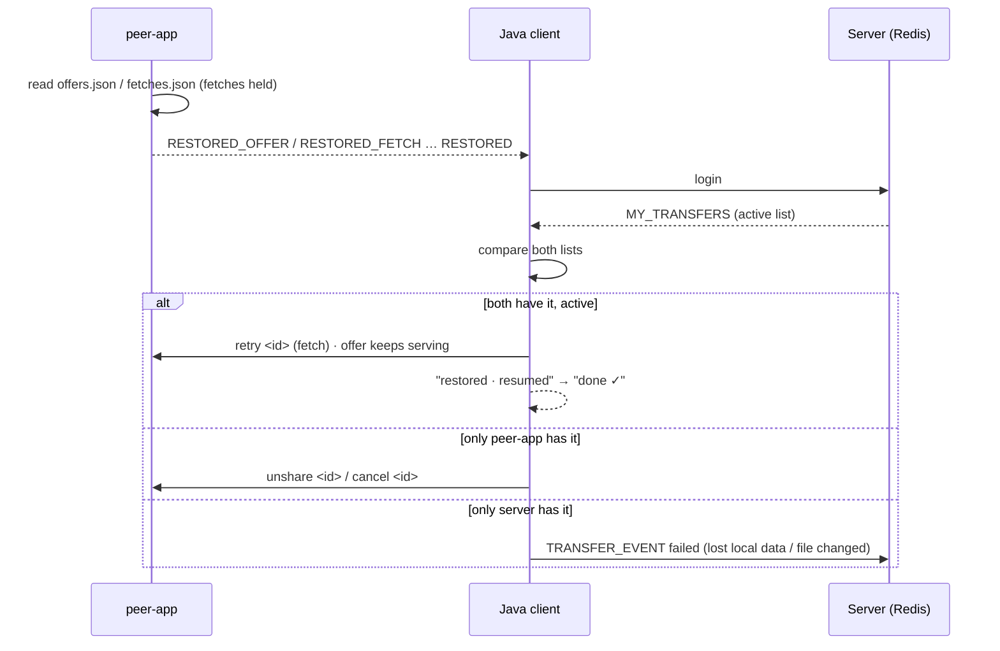

# B3c: Agree After a Restart

**Status:** 🔄 Design done · code next on branch `phase-b3cd-cleanup`
Problem and test results: [Restart sync findings](../problems/Before-PhaseB3c-restart-sync-findings.md)
Related: [File transfer improvement plan](../future-plans/File-transfer-improvement-plan.md) · [Mesh v2](mesh-v2.md) · [peer-app protocol](../peer-app-protocol.md)

---

## Rule

**peer-app never acts alone after a restart. The server stays the boss.**

**Scope:** B3c must pass the 7 main cases + E1 (reconnect without restart) + E2 (restart before the transfer began). E3–E8 are noted and fixed later; the goal is to reach the dashboard (D1).

| Finding | Fixed by |
|---|---|
| R2 Java forgets | 3.2 + 3.3: Java rebuilds its list from peer-app + server |
| R3 peer-app acts alone | 3.1: receiver's download held until Java says go |
| R4 30 s vs 30 min | 3.4: receiver gets 30 min too |
| R5 different answers | 3.3: one decision per transfer, the server's state wins |
| R6, R7 dead transfer waits | 3.3: "report failed" at once |
| R8 sender not told | 3.3: Java knows restored items, so it prints dropped / expired |
| R9, R10 mesh % and minutes | B3d |

---

## 3.1 Hold the receiver on restore (peer-app)

Only the side that **acts** is held. The receiver downloads and reports progress; the sender only answers requests from peers on its allow-list.

| Restored item | Behaviour |
|---|---|
| **Fetch** (receiver) | **Not started**: waits for `retry <id>` (go) or `cancel <id>` (delete) from Java |
| **Offer** (sender) | **Not locked**: serves as today; Java removes it with `unshare <id>` if the server says it is over |

Why the sender needs no lock:
- Nobody fetches a dead offer: the receiver's own download is expired (same TTL), cancelled, or held until its Java checks.
- Sender Java learns the restored offers at startup and logs in within ~1 s; the receiver only retries after "sender joined".
- The mesh only shows the server's state, and the server ignores events for a finished transfer (Lua "final" rule), so the mesh stays truthful anyway.

One line per restored item, then the summary (Java treats the summary as "list complete"):

```
EVENT:RESTORED_OFFER:<id>:<hash>:<size>:<file name>
EVENT:RESTORED_FETCH:<id>:<hash>:<size>:<bytes_on_disk>:<file name>
EVENT:RESTORED:<offers>:<fetches>
```

No new commands: `retry`, `cancel` and `unshare` already exist. A held fetch still expires with the normal TTL, so nothing stays stuck if Java never answers.

## 3.2 Server tells the client its transfers on login

```
MY_TRANSFERS|<id>:<state>:<from>:<to>:<pct>,…
```

Active transfers of that user (started / moving / retrying / waiting), from Redis. For now a scan of `transfers:active`; later the per-user index `transfers:user:<name>` (also needed by the user app).

## 3.3 Java compares both lists

| peer-app has it | Server: active | Java does |
|---|---|---|
| ✅ | ✅ | **go**: `retry` (fetch); the offer just keeps serving; back in the list; prints "restored · resumed", later "done ✓" |
| ✅ | ❌ (failed / done / unknown) | **delete**: `unshare` (offer) or `cancel` (fetch, partial data removed); prints why |
| ❌ | ✅ | **report failed**: "lost local data", or "file changed" if peer-app printed `OFFER_DROPPED`; the other side stops waiting at once |

Java saves nothing new: peer-app knows **what** (file, hash, bytes on disk), the server knows **who and how far** (from, to, state, %).



## 3.4 Receiver gets 30 min too (server)

Today a receiver who leaves is failed after 30 s ("peer left"). With B3c it becomes **waiting for receiver** until the TTL, the same as a sender who leaves.

| Who goes offline | Server shows | Deadline |
|---|---|---|
| Sender | waiting for sender | transfer start + TTL |
| Receiver *(new)* | waiting for receiver | transfer start + TTL |

- The deadline counts from the **transfer start** (same clock as peer-app's `created_ms`), not from the disconnect.
- The "receiver left" step must set state **waiting with `wait_until`**; otherwise the 120 s silence rule would kill it.
- Mesh: the same purple dashed line, label "waiting for receiver".

### All cases after B3c

| # | Case | Result |
|---|---|---|
| 1 | Short blip | continues by itself (iroh / quick tries) ✅ |
| 2 | Sender offline, back in time | resumes ✅ |
| 3 | Receiver offline, back in time | resumes ✅ |
| 4 | Both offline, back in time | resumes ✅ |
| 5 | Someone offline past the TTL | expires, both sides clean up, clear message ❌ |
| 6 | Data lost | reported failed at once ❌ |
| 7 | Sender's file changed | reported failed at once, never a wrong file ❌ |

Cases 1–4 always end in a resume; 5–7 end in a clean, fast failure with a clear message.

## 3.5 Sweeper (server backup)

| State | Failed after |
|---|---|
| started / moving / retrying | 120 s without any event (unchanged) |
| waiting for sender | deadline + 2 min (unchanged) |
| waiting for receiver *(new)* | deadline + 2 min; here the sweeper **is** the one that expires it |
| check interval | every 15 s (unchanged) |

Server and peer-app read the same `PEER_TRANSFER_TTL_SECS` (default 1800 s).

## 3.6 Decisions

- **Receiver back after the server said failed** (only after the TTL now): **cancel**, partial data deleted, clear message.
- **Queued transfers** (not started yet) are memory only and are **not** restored; the user sends again.
- **Only the receiver is held** on restore; the sender's offer is not locked (see 3.1).
- **TTL counts from the transfer start**, not from each disconnect, so a transfer can't live forever.
- **Known limit:** resuming waits for the server's OK, so with the server down, peers can't resume even if they reach each other. That matches today's design (chat, presence and `PEER_INFO` already need the server). Later (Phase D / island mode): after N minutes without the server, peer-app may resume on its own and report when the server is back.

## 3.7 Edge cases

| # | Case | Rule | When |
|---|---|---|---|
| E1 | Reconnect without restart (Java and peer-app kept running) | Compare only IDs Java doesn't already know; the next progress moves waiting → moving | **B3c** |
| E2 | Restart before the transfer began (state `started`, no fetch / offer yet) | Report failed "restarted before the transfer began", not "lost local data" | **B3c** |
| E3 | Server not reachable at startup | Print "restored N transfers · waiting for server"; compare when connected; TTL is the safety net | later |
| E4 | Redis lost its data | `MY_TRANSFERS` empty → restored items deleted; check Redis persistence (AOF); accepted for now | later |
| E5 | Double retry (B3b "sender back" + B3c "go") | `already fetching` = OK, not shown | later |
| E6 | Laptop clock differs from Redis clock | 2 min margin; server state wins | later |
| E7 | Bots on the old build | Rebuild client image with the server (`:b3c`); test in B4 | B4 |
| E8 | Same user started twice | Blob store lock + "superseded" already stop it; keep as a test | later |

---

## 4. Changes

| Step | Where | Change |
|---|---|---|
| 1 | peer-app `blobs.rs`, `main.rs` | restored fetches not started (wait for `retry`); `RESTORED_OFFER` / `RESTORED_FETCH` lines before `RESTORED`; unit tests |
| 2 | Server `TransferTracker`, `TransferStore`, `ClientHandler` | `MY_TRANSFERS` on login; receiver left → waiting (deadline = start + TTL); sweeper rule for waiting-for-receiver |
| 3 | Java `Client.java` | collect both lists, compare, go / delete / report failed; handle `OFFER_DROPPED` / `OFFER_EXPIRED` for restored items; E1 + E2; terminal messages; `/status` shows restored transfers |
| 4 | `mesh.html` | "waiting for receiver" label |
| 5 | Docs | peer-app protocol (new events), mesh-v2 (`MY_TRANSFERS`, receiver waiting), results after B3c in the findings doc |

---

## 5. Tests after B3c

Same setup and cases as the [findings](../problems/Before-PhaseB3c-restart-sync-findings.md#test-setup):

| # | Case | Expected |
|---|---|---|
| 1 | Short blip | unchanged: continues, done on both sides |
| 2 | Sender offline, back | sender: "restored · resumed" → "done ✓"; receiver resumes |
| 3 | Receiver offline 1 min | server: **waiting for receiver**; receiver: "restored · resumed from X MB" → "done ✓"; counted once as done |
| 4 | Both offline | both print restored → done; server: done |
| 5 | Offline too long | expired, cleaned up; the side coming back late prints "old transfer closed: expired" |
| 6 | Receiver lost its data | receiver reports failed ("lost local data") at once; sender stops sharing at once |
| 7 | Sender's file changed | sender reports failed ("file changed") at once; receiver cancels instead of waiting |
| E1 | Wi-Fi drop > 30 s, no restart | waiting → moving again; nothing started twice |
| E2 | Restart right after accepting | failed: "restarted before the transfer began" |
| — | Receiver away 4 min | sweeper doesn't kill it; resumes |

---

## 6. Left for B3d

- Mesh "% kept" (R9): send `pct` with retrying / waiting.
- "already had it" instead of `done (none)`.
- Fade the offline peer's node on the mesh while its transfer is waiting.
