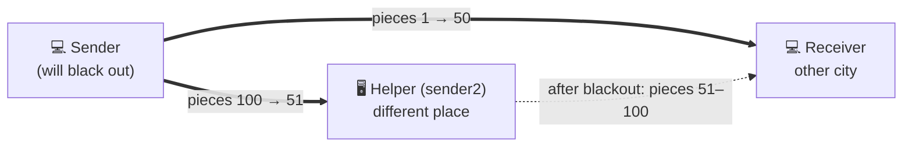

# 💡 Idea: Helper peer for blackouts

> **Status:** idea, not planned yet · **Fits in:** B4/B5 (after D1), as the resilience part of [swarm-distribution-plan.md](../future-plans/swarm-distribution-plan.md)
> **Related:** [island mode](#related) · [PhaseB3d-cleanup.md](../fixes/PhaseB3d-cleanup.md) (pause and resume)

---

## The problem

A user is sending a file to someone in another city, and **the power goes out in the sender's area**. The router dies, and maybe the mobile towers die too. The sender's laptop is cut off.

Today Aperture **pauses** the transfer. The receiver keeps its pieces (🔒 locked) and waits **30 minutes** for the sender. Blackouts often last hours, so after 30 minutes the transfer fails.

## The key insight

> You can't move data **through** a blackout.
> But you can move it **out before** the blackout hits.

If the whole file already exists somewhere outside the sender's laptop, the sender going dark doesn't matter. The receiver gets the rest from that other place.

---

## The idea: meet in the middle

While the sender sends the file to the receiver **from the start**, a **helper peer (sender2)** pulls the same file **from the end, backwards**.

1. The receiver gets pieces **1, 2, 3 …** from the sender.
2. The helper gets pieces **100, 99, 98 …** from the sender.
3. When they **meet in the middle**, the whole file is outside the sender's laptop.
4. If the sender blacks out, the receiver fetches the remaining pieces **from the helper**.

### Why this works

- **Every piece is checked against the BLAKE3 hash** (iroh-blobs), so the receiver doesn't care *who* sends a piece. A wrong piece is rejected either way.
- **No extra upload:** the sender uploads each piece only once, split across two destinations. It's the same total as a normal transfer.
- **The risk window is the same or smaller:** they meet at about the point where a normal transfer would have finished.

---

## Challenges and fixes

| Challenge | Fix |
|---|---|
| 🔒 **Privacy:** the helper holds someone else's file | **Encrypt the file for the receiver before sharing.** The helper stores data it can't read, and the hash check still works. Without this, it breaks the "Private" promise. |
| 🖥️ **Who is the helper?** | Start: an always-on helper we run (cloud or EC2), only for encrypted pieces. Later: any trusted peer that offers to help. |
| ⚡ **The helper is in the same blackout** | Pick a helper in a **different place** (another city, or the cloud). |
| ⏱️ **Blackout before they meet** | The middle pieces are lost. Unavoidable, but the window is no bigger than a normal transfer's. |
| 🔎 **The receiver must find the helper** | The server tells the receiver ("hash X is also at helper"), or later an **iroh-docs** record of who has which hash (a shared "mind"). |
| 🧹 **Cleanup** | The helper deletes the pieces when the receiver reports done, or after a time limit. |
| 📥 **The receiver is the one in the blackout** | This idea doesn't help that side, but it's already handled: the receiver keeps its pieces and resumes later. A longer wait than 30 min is needed for blackouts. |

---

## Blackout cases (for context)

| Situation | Can it finish? | How |
|---|---|---|
| Both inside, mobile towers working | ✅ | Switch to mobile data or a hotspot, then resume |
| Both inside, towers down | ✅ | A phone hotspot (no internet needed) + **local discovery (mDNS)** |
| One inside, has mobile data | ✅ | Resume over mobile data |
| **Sender inside, no path out** | ✅ **with this idea** | Receiver finishes from the helper |
| Receiver inside, no path out | ⏸️ | Pauses safely, resumes later (needs a longer wait) |

---

## Build steps (when it's picked up)

1. **Multi-provider fetch:** the receiver can fetch the rest of a hash from a second provider.
2. **Helper pulls the back half:** the helper requests pieces from the end while the transfer runs (iroh-blobs range requests; check the API for 0.103).
3. **Encryption:** the file is encrypted for the receiver, so helpers can't read it.
4. **Finding the helper:** the server passes "also at helper", later via iroh-docs.
5. **Cleanup:** the helper deletes after done or after a time limit.
6. **Later:** erasure coding (below).

Each step ends with a test: kill the sender after the meeting point, and check that the receiver finishes from the helper with a sha256 match.

---

## Going further: erasure coding

Instead of one helper holding plain pieces, give **3 helpers coded pieces** so that **any 2 of them** are enough to rebuild the file. That survives more failures with less storage (Reed-Solomon, fountain codes).

---

## Research and existing systems

- **Delay-Tolerant Networking (DTN):** "store-and-forward" and **custody transfer** (Bundle Protocol, RFC 9171). Data is handed to a node that carries it on, so the sender can disappear. It was built for space links and disaster areas.
- **BitTorrent / IPFS:** the same file from many sources, checked by hash. IPFS **pinning services** are this "helper" idea as a product.
- **Erasure coding:** Reed-Solomon, fountain codes (any *k* of *n* pieces rebuild the file).
- **iroh-blobs:** content-addressed, supports fetching ranges and fetching from more than one provider. Check the exact API in the version we use.

---

## Related

- `future-plans/swarm-distribution-plan.md`: one file from many peers (this idea is its resilience version)
- Island mode: a cut-off region works as its own local network (local discovery + a local relay)
- Decision 005: self-hosted relay (a relay *inside* a cut-off area)
