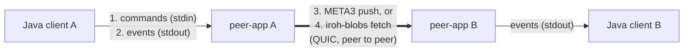
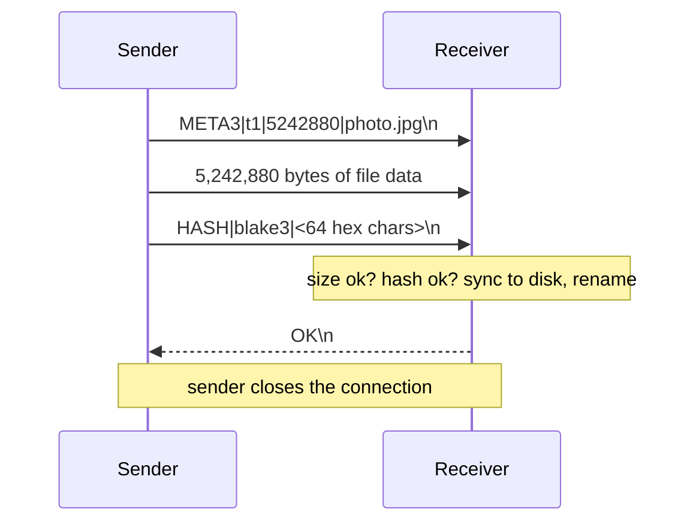
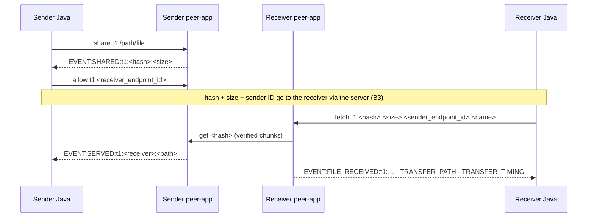
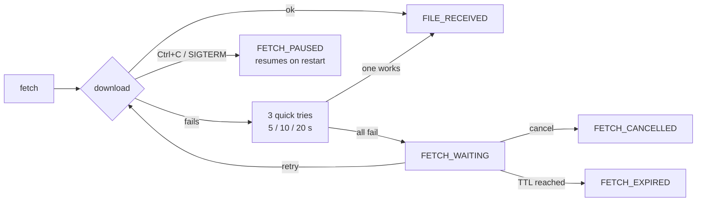
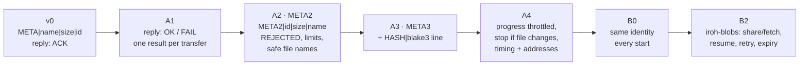

# peer-app Protocol

> How Aperture's peer-app talks — to the Java client, and to other peer-apps —
> and how it got this shape. Current versions: **META3** (Phase A4, still used by Java)
> and **iroh-blobs** (Phase B2; used by Java since B3a, default `TRANSFER_PROTOCOL=blobs`).

## The big picture

peer-app is a small Rust program (built on Iroh) that moves files between
two computers. It never talks to the user directly. It speaks two "languages":

| Part | Between | How | Example |
|---|---|---|---|
| Commands | Java → peer-app | lines on stdin | `sendto t1 <id> <relay> /path/file` · `fetch t1 <hash> …` |
| Events | peer-app → Java | lines on stdout | `EVENT:FILE_RECEIVED:t1:…` |
| META3 transfer | peer-app ↔ peer-app | bytes on a QUIC stream (ALPN `p2papp/file/0`) | `META3|t1|5242880|photo.jpg` … |
| Blobs transfer | peer-app ↔ peer-app | iroh-blobs protocol (receiver pulls) | verified chunks, resumable |

The signaling server never sees file data. It only helps two clients find
each other (endpoint ID + relay URL). The file goes peer to peer.

Both protocols run on **one** Iroh endpoint with **one** identity (B0), routed by ALPN.

---

## Part 1: Commands (Java → peer-app)

| Command | Meaning |
|---|---|
| `sendto <transfer_id> <endpoint_id> <relay_url> <file_path>` | Send a file to that peer (META3) |
| `sendto <transfer_id> <endpoint_id> - <file_path>` | Same, without a relay hint (dial by ID only) |
| `quit` | Shut down |

Blobs commands (`share`, `allow`, `unshare`, `fetch`, `retry`, `cancel`) are in **Part 4**.

- `transfer_id`: letters, digits, `-`, `_`, max 64 chars (Java uses UUIDs).
- `relay_url` is only a **hint** — Iroh's discovery finds the peer by its ID
  even if the URL is wrong (tested: bug 10).
- `file_path` may contain spaces (it is the last field).
- Ctrl+C or SIGTERM (Kubernetes, Java's `destroy()`) = `quit`: peer-app saves its state and exits (B2b-1).

## Part 2: Events (peer-app → Java)

Every line starts with `EVENT:`. Java reacts to the ones it knows and prints
or ignores the rest.

### At startup

| Event | Meaning |
|---|---|
| `EVENT:IDENTITY:<created\|loaded\|…>:<where>` | Where my key came from (key file in the data folder, or seed) — B0 |
| `EVENT:BLOB_STORE:<path>` | My blob store folder — B2 |
| `EVENT:ENDPOINT_READY:<endpoint_id>` | My Iroh identity (same every start since B0) |
| `EVENT:RELAY_READY:<relay_url>` | My home relay |
| `EVENT:ENDPOINT_ADDRS:<ip:port,…>` | Direct addresses I know (local + public) — for debugging relay vs direct |
| `EVENT:CHUNK_SIZE:<bytes>` | Read/write chunk size in use (META3) |
| `EVENT:TRANSFER_TTL:<seconds>` | How long shares and fetches live — B2b-2 |
| `EVENT:RESTORED:<offers>:<fetches>` | Saved shares / unfinished fetches brought back after a restart — B2b-1 |
| `EVENT:READY_FOR_COMMANDS:` | Ready for commands |

### During a transfer

| Event | Side | Meaning |
|---|---|---|
| `EVENT:PROGRESS:sending\|<name>\|<pct>\|<bytes>\|<total>\|<id>` | sender | Progress (max ~100 lines per transfer) |
| `EVENT:PROGRESS:receiving\|…` | receiver | Same, receiving side (blobs: includes bytes already on disk) |
| `EVENT:CONNECTION_PATH:<id>:<direct\|relay>` | both | Live path — at start and on every switch |
| `EVENT:FILE_HASH:<id>:blake3:<hex>` | both | Hash each side computed |

### Results — each transfer ends with exactly ONE result per side

| Event | Side | Meaning | Java does |
|---|---|---|---|
| `EVENT:FILE_RECEIVED:<id>:<saved_path>\|<bytes>` | receiver | Saved, hash OK | — |
| `EVENT:TRANSFER_PATH:<id>:<direct\|relay>` | receiver | Final path (only after success) | counts **one** success metric |
| `EVENT:TRANSFER_TIMING:<id>:data_ms=… …` | receiver | Where the time went (blobs adds `export_ms`, `resumed_bytes`, `protocol=blobs`) | ignores |
| `EVENT:TRANSFER_FAILED:<id>:<reason>` | receiver | Receiver failed (incomplete, hash mismatch, disk, expired…) | reports failure |
| `EVENT:FILE_SENT:<id>:<path>` | sender | Receiver confirmed OK (META3) | — |
| `EVENT:FILE_SEND_FAILED:<id>:<reason>` | sender | Receiver failed and **already reported it** (META3) | does not report again |
| `EVENT:TRANSFER_FAILED:<id>:sender: <reason>` | sender | Failure only the sender knows (can't connect, rejected, no reply) | reports failure |

### Other

| Event | Meaning |
|---|---|
| `EVENT:INCOMING_REJECTED:<reason>` | Someone connected but sent a bad header / handshake failed. No transfer ID yet |
| `EVENT:SHUTDOWN:signal` | Ctrl+C / SIGTERM received; saving and exiting — B2b-1 |
| `EVENT:ERROR:<message>` | Bad command or startup problem (not tied to a transfer) |

**The golden rule (from A1):** every transfer is reported **once** —
success by the receiver, failure by whichever side knows about it.

---

## Part 3: META3 transfer protocol (peer-app ↔ peer-app)

One QUIC connection, ALPN `p2papp/file/0`, one bidirectional stream.

### Messages

| Message | Direction | Format | Limits |
|---|---|---|---|
| Header | S → R | `META3|<id>|<size>|<name>\n` | max 1 KB, whole line within 40 s |
| Data | S → R | exactly `<size>` raw bytes | stall > 40 s = fail |
| Hash | S → R | `HASH|blake3|<hex>\n` | max 100 bytes, within 10 s |
| Reply | R → S | `OK\n` · `FAIL|<reason>\n` · `REJECTED|<reason>\n` | sender waits max 60 s |

| Reply | Meaning | Sender prints |
|---|---|---|
| `OK` | File saved and verified | `FILE_SENT` |
| `FAIL|reason` | Receiver failed, already reported | `FILE_SEND_FAILED` |
| `REJECTED|reason` | Header refused — receiver has no valid ID to report with | `TRANSFER_FAILED … receiver rejected` |

### What the receiver checks

- Header starts with `META3|` — otherwise *"different header version"*.
- Valid transfer ID, valid size; name is **cleaned** (no `../`, no `| : ? *`, max 100 chars).
- Reads **exactly** `size` bytes — never more.
- Hash line matches its own BLAKE3 of what it wrote — otherwise *"hash mismatch"*.
- Nothing after the hash line.
- `flush` + `sync_all` before the file gets its final name.

### Files on the receiver

| File | When |
|---|---|
| `received_<id>.partial` | while receiving (created "new only" — two transfers never share it) |
| `received_<first 8 of id>_<name>` | after success (`_2`, `_3` … if the name exists — never overwrites) |
| — | partial deleted on any failure |

### Example failures

| What happened | Receiver | Sender |
|---|---|---|
| File shrinks while sending | `TRANSFER_FAILED:… read error` (stream reset) | `FILE_SEND_FAILED:… file changed while sending` |
| One byte corrupted | `TRANSFER_FAILED:… hash mismatch` | `FILE_SEND_FAILED:… hash mismatch` |
| Receiver offline | — | `TRANSFER_FAILED:… sender: timed out` |
| Old peer-app on one side | `INCOMING_REJECTED: different header version` | `TRANSFER_FAILED:… receiver rejected` |

---

## Part 4: Blobs — "share, then fetch" (Phase B2)

The **receiver pulls**; the sender stays passive. iroh-blobs checks every chunk
against the BLAKE3 hash as it arrives, and chunks already received are kept,
so a fetch can always continue where it stopped.

### Commands

| Command | Side | Meaning |
|---|---|---|
| `share <id> <file_path>` | sender | Hash the file in place (no copy) and offer it |
| `allow <id> <endpoint_id>` | sender | This peer may fetch this offer (nobody else can) |
| `unshare <id>` | sender | Stop offering it |
| `fetch <id> <hash> <size> <sender_endpoint_id> <name>` | receiver | Pull the file (name last, may contain spaces) |
| `retry <id>` / `retry all` | receiver | Try a waiting fetch again now (Java sends it when the server says the sender is back) |
| `cancel <id>` | receiver | Stop a fetch and delete its partial data |

### Events

| Event | Side | Meaning |
|---|---|---|
| `EVENT:SHARED:<id>:<hash>:<size>` | sender | Offer ready |
| `EVENT:SHARE_TIMING:<id>:hash_ms=…` | sender | Time to hash the file |
| `EVENT:ALLOWED:<id>:<endpoint_id>` | sender | Peer added to the allow-list |
| `EVENT:UNSHARED:<id>` | sender | Offer removed |
| `EVENT:SERVED:<id>:<peer>:<direct\|relay>` | sender | The receiver got everything it asked for |
| `EVENT:PEER_REJECTED:<peer>:<hash or ->` | sender | Someone not on the allow-list tried — refused before any data |
| `EVENT:OFFER_DROPPED:<id>:<reason>` | sender | At startup: the shared file changed or disappeared while peer-app was off |
| `EVENT:OFFER_EXPIRED:<id>` | sender | Offer older than the TTL, removed |
| `EVENT:RESUMED:<id>:<bytes>` | receiver | Continuing with `<bytes>` already on disk |
| `EVENT:FETCH_RETRYING:<id>:<n>:<secs>:<reason>` | receiver | Quick try `n` of 3 in `<secs>` (5 / 10 / 20 s) |
| `EVENT:FETCH_WAITING:<id>:<secs_left>:<reason>` | receiver | Quick tries failed; data kept; waiting for `retry` |
| `EVENT:FETCH_PAUSED:<id>:…` | receiver | Interrupted by shutdown; resumes on the next start |
| `EVENT:RETRY:<id>` / `EVENT:RETRY_ALL:<n>` | receiver | A retry started |
| `EVENT:FETCH_CANCELLED:<id>` | receiver | Cancelled, data deleted |
| `EVENT:FETCH_EXPIRED:<id>` + `EVENT:TRANSFER_FAILED:<id>:expired…` | receiver | TTL reached without finishing; data deleted |

### The data folder

`PEER_DATA_DIR`, default `~/.aperture/<username>/`:

| File / folder | What |
|---|---|
| `secret.key` | My identity (0600). Not used when `PEER_KEY_SEED` is set (bots) |
| `blobs/` | iroh-blobs store; data without a tag is garbage-collected every 60 s |
| `offers.json` | My shares (file path, size, modified time, allowed peers, created time) |
| `fetches.json` | My unfinished fetches (hash, size, sender, name, created time) |

Saved with temp file → rename; a damaged file is moved to `*.bad` and peer-app starts empty.

### Settings

| Variable | Default | Meaning |
|---|---|---|
| `PEER_DATA_DIR` | `~/.aperture/<username>` | Data folder |
| `PEER_KEY_SEED` | — | Derive the key from a seed (bots: same ID per bot name without a key file) |
| `PEER_TRANSFER_TTL_SECS` | `1800` | Lifetime of shares and fetches |
| `PEER_BINARY_PATH` | — | (Java) which peer-app binary to start |

### Lifecycle of a fetch

Tested with `tools/blobs-test.sh` (8 scenarios, all pass).

---

## How it got this shape

Each version fixed something we **measured first** with
`tools/peer_bug_check.py` (evidence in `docs/problems/evidence/`).

| Version | Problem (bug #) | Change | Why this way |
|---|---|---|---|
| **v0** | — | `META|name|size|id`, raw data, receiver replies `ACK` | Simplest thing that works |
| **A1** | Sender said "sent" even when receiver failed (1); path reported after failure (2); one transfer counted twice (3); sender errors invisible to Java (4) | Receiver replies `OK` or `FAIL|reason`; only the receiver reports success; sender failures become `TRANSFER_FAILED` | The receiver is the only side that knows if the file is really saved. One reporter = no double counting |
| **A2** | Same name from two senders corrupted the file (5); no sync before rename (6); `|` in a name broke the header (8); unlimited header (12) | New header **META2** with the **name last**; per-transfer `.partial`; names cleaned; 1 KB header limit; `REJECTED` reply | Name last → `splitn(3)` keeps `|` inside the name. Version tag → mismatched builds fail clearly instead of silently |
| **A3** | No integrity check (7) | **META3** + `HASH|blake3|…` **after** the data | Hash while streaming → file read only once. BLAKE3 is fast and is what iroh-blobs uses |
| **A4** | 16,000 progress lines per 500 MB (11); file changing mid-send produced confusing errors | Progress max ~100 lines; sender sends exactly `size` bytes and stops if the file shrinks; `TRANSFER_TIMING`, `ENDPOINT_ADDRS` | Less noise for Java; clear reason; data to explain relay vs direct |
| **B0** | New ID on every restart: nobody could find a peer that came back | Key in the data folder or derived from a seed; one `Router` for all protocols | Same ID = others can reconnect; bots get stable IDs without volumes |
| **B2** | No resume; a restart or offline sender lost the whole transfer | iroh-blobs share/fetch, allow-list, saved state, quick tries, waiting, retry, cancel, TTL, clean shutdown | Verified chunks and resume from the library; we add who-may-fetch, persistence and waiting |

### Design rules that came out of this

1. **One result per transfer per side, reported once.**
2. **The receiver is the judge** of success — it holds the file.
3. **Never trust the other side**: limit sizes, clean names, verify the hash.
4. **Version the header** — mismatched builds must fail loudly.
5. **Measure before and after** every change.
6. **Saving isn't exiting** — after saving, exit explicitly (B2b-1 stdin hang).
7. **Retry short hiccups yourself; let the server trigger long waits** (B2b-2).

## Compatibility

- META3: both peers must run the **same header version**. An older peer
  gets `REJECTED: different header version`.
- After building, update **both** copies: `peer-binary/peer` (bot image) and
  `~/peer-app/target/release/peer` (admin client), or set `PEER_BINARY_PATH`.
  Current binary: B2 (`8b386b…`), image `shobhit3718/dummy-client:b2`.

## What comes next

- **B3:** the Java client switches from `sendto` (META3) to `share` / `allow` / `fetch`;
  the server passes hash + size + sender ID to the receiver and announces when a
  sender is back (→ `retry`).
- **B5:** META3 (Part 3) is removed.
- See `docs/future-plans/File-transfer-improvement-plan.md`.

---

## Part 5 – B3c / B3d additions

### Events (peer-app → Java)

| Event | When | Java does |
|---|---|---|
| `RESTORED_OFFER:<id>:<hash>:<size>:<name>` | at start, a saved share came back | keeps it until the restart check |
| `RESTORED_FETCH:<id>:<hash>:<size>:<bytes_on_disk>:<name>` | at start, a saved fetch came back (**not** started by itself) | `retry <id>` (resume) or `cancel <id>` after the check |
| `RESTORED:<offers>:<fetches>` | the restored list is complete | runs the restart check once both lists are in |
| `OFFER_DROPPED:<id>:<reason>\|<name>` | a saved share could not be kept: `file changed while peer-app was off`, file gone, or `expired while peer-app was off` | shows the name; tells the receiver it failed |
| `FETCH_RETRYING:<id>:<n>:<secs>:<reason>` | quick try n of 3 (5 / 10 / 20 s). B3d: n starts again at 1 when data moved since the last try | mesh "reconnecting n/3" (latest % sent first) |
| `FETCH_WAITING:<id>:<secs_left>:<reason>` | 3 tries failed, chunks kept | 🔒 locked; mesh "waiting for sender" (latest % sent first) |
| `RESUMED:<id>:<bytes>` | a fetch continues from bytes already on disk | shown once per value |
| `PEER_REJECTED:<endpoint>:…` | a request for a share this peer-app doesn't have / doesn't allow | quiet |
| `SHUTDOWN:<why>` | peer-app stopping | quiet |

### Timing (B3d)
- Downloader connect timeout: **10 s** (iroh-blobs default was 1 s → first try failed).
- Quick tries: 5 s, 10 s, 20 s, then `FETCH_WAITING` until the TTL (`PEER_TRANSFER_TTL_SECS`, default 30 min).

### Client side (Java, for reference)
- Waits up to **60 s** for `ENDPOINT_READY` + `RELAY_READY`, otherwise exits with code **4**.
- Exit codes: `3` username taken · `4` peer-app never ready · `5` server unreachable longer than `RECONNECT_GIVE_UP_SECS` (default 600).
